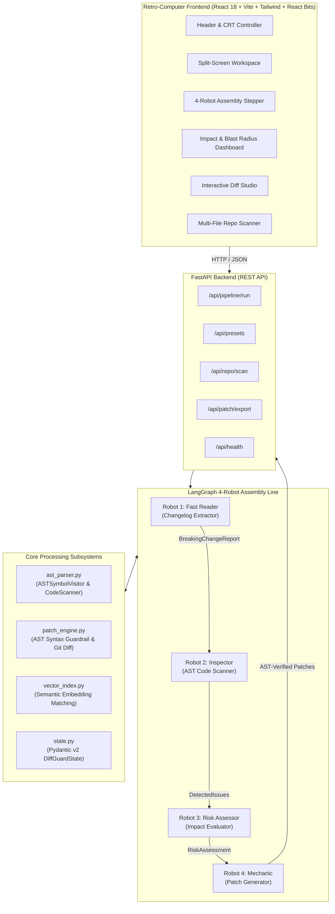

# DiffGuard AI — Technical Application Documentation

## 1. Project Overview
**DiffGuard AI** is the "Digital Mechanic for Broken Software Integrations". Modern software architectures rely heavily on third-party SDKs and cloud APIs (e.g., Stripe, OpenAI, Twilio, AWS, Pydantic, FastAPI). When an upstream provider releases a breaking revision (deprecating endpoints, modifying parameter types, renaming arguments, or altering return schemas), client-side applications crash with unhandled runtime errors (`AttributeError`, `TypeError`, or 400/404 responses).

Human software engineers traditionally spend dozens of hours manually reading massive 50-page changelog documents, searching repositories line-by-line, and refactoring broken code by hand.

DiffGuard AI automates this entire lifecycle using a LangGraph-powered 4-robot assembly line paired with Python's native Abstract Syntax Tree (`ast`) and semantic vector similarity. It converts unstructured release notes into structured breaking changes, pinpoints broken call sites with exact line coordinates, evaluates crash severity using a traffic-light rating (RED / YELLOW / GREEN), and synthesizes AST-validated code patches with unified git diffs (`diff -u`).

### Key Features
- **Robot 1: The Fast Reader (Changelog Extractor)**: Extracts structured breaking changes from markdown changelogs, raw text, or OpenAPI specs into validated Pydantic v2 schemas.
- **Robot 2: The Inspector (AST Code Scanner)**: Analyzes user code using Python's native `ast.NodeVisitor` to detect deprecated function calls, altered parameter names, import aliases, and decorator shifts with line-level precision.
- **Robot 3: The Risk Assessor (Impact Evaluator)**: Analyzes crash probability, assigning a 0-100 risk score and traffic-light rating (RED for fatal crashes, YELLOW for warnings, GREEN for safe).
- **Robot 4: The Mechanic (Patch Generator & AST Guardrail)**: Generates refactored code and unified git diffs, strictly verifying that 100% of generated patches compile cleanly with `ast.parse()` before presentation.
- **Retro-Computer-Inspired UI**: Dark mode UI built with Tailwind CSS, Midnight Slate (`#0F172A`) backgrounds, Electric Indigo (`#6366F1`) neons, toggleable CRT scanlines, and animated React Bits components (`DecryptedText`, `SpotlightCard`, `ShinyText`, `Squares`).
- **Multi-File & Repository Scanner**: Scans entire directory trees, identifies affected files, and generates a unified batch `.diff` patch bundle.
- **Curated Real-World Presets**: Built-in migration scenarios for Stripe (`Charge.create` -> `PaymentIntent.create`), OpenAI (`v0.28` -> `v1.0.0`), and Pydantic (`v1` -> `v2`).

---

## 2. Technology Stack

### Backend Stack
- **Language**: Python 3.13.7
- **Web Framework**: FastAPI 0.143+ (Asynchronous ASGI)
- **Data Validation & Modeling**: Pydantic v2 (Strict type schemas)
- **AST Engine**: Python Native `ast` module (`ast.parse`, `ast.NodeVisitor`, `ast.walk`)
- **Semantic Vector Indexing**: In-memory TF-IDF and character n-gram cosine vector similarity (`VectorIndex`)
- **Diff Engine**: Python standard library `difflib.unified_diff`
- **Testing Framework**: Pytest 9.1+, Pytest-Asyncio, Starlette TestClient, HTTPX

### Frontend Stack
- **Language**: TypeScript 5.4+
- **Framework**: React 18.3.1
- **Build Tool & Dev Server**: Vite 5.2+
- **Styling**: Tailwind CSS 3.4+, PostCSS, Autoprefixer
- **Icons**: Lucide React
- **React Bits Components**: `DecryptedText`, `SpotlightCard`, `ShinyText`, `Squares`
- **Testing Framework**: Vitest 1.6+, React Testing Library, JSDOM

---

## 3. System Architecture

The system is partitioned into a decoupled full-stack architecture:



---

## 4. Project Structure

```
D:\production projects\diffguard-ai\
├── PRD.md                             # Product Requirements Document
├── architecture.md                    # System Flow & StateGraph Blueprints
├── rules.md                           # Strict Engineering Guardrails (AST parsing, Pydantic v2)
├── phases.md                          # 4-Week Sprint Development Roadmap
├── design.md                          # UI & Theme Design System Specification
├── memory.md                          # Living Project Memory & ADR Logs
├── APPLICATION_DOCUMENTATION.md       # Comprehensive Technical Documentation
├── start.ps1                          # PowerShell launcher script
├── backend/                           # FastAPI Python Backend
│   ├── app/
│   │   ├── __init__.py                # Package initializer
│   │   ├── main.py                    # FastAPI application entrypoint & CORS
│   │   ├── config.py                  # Configuration settings & environment variables
│   │   ├── models/
│   │   │   ├── __init__.py
│   │   │   ├── schemas.py             # Pydantic v2 DTO schemas
│   │   │   └── state.py               # DiffGuardState StateGraph schema
│   │   ├── engine/
│   │   │   ├── __init__.py
│   │   │   ├── ast_parser.py          # Native AST NodeVisitor & CodeScanner
│   │   │   ├── vector_index.py        # Semantic vector similarity engine
│   │   │   ├── patch_engine.py        # AST syntax validation guardrail & diff generator
│   │   │   └── langgraph_assembly.py  # 4-Robot Assembly Line orchestrator
│   │   └── api/
│   │       ├── __init__.py
│   │       ├── presets.py             # Curated Stripe, OpenAI, Pydantic migration presets
│   │       └── router.py              # REST API endpoint routes
│   ├── tests/
│   │   ├── __init__.py
│   │   ├── test_ast_parser.py         # Pytest for AST visitor & alias resolution
│   │   ├── test_patch_engine.py       # Pytest for AST validation & diff generation
│   │   ├── test_langgraph_pipeline.py # Pytest for 4-robot assembly line
│   │   └── test_api_endpoints.py      # Pytest for FastAPI REST endpoints
│   └── requirements.txt               # Backend Python dependencies
└── frontend/                          # Vite + React + TypeScript Frontend
    ├── package.json                   # Node packages and scripts
    ├── vite.config.ts                 # Vite bundler & test proxy configuration
    ├── tsconfig.json                  # TypeScript compiler configuration
    ├── tailwind.config.js             # Tailwind CSS tokens & cyber animations
    ├── postcss.config.js              # PostCSS plugins
    ├── index.html                     # HTML root with JetBrains Mono font
    ├── src/
    │   ├── main.tsx                   # React root mount
    │   ├── App.tsx                    # Top-level state and tab coordinator
    │   ├── index.css                  # Retro CRT scanlines, vignette, glowing styles
    │   ├── types/
    │   │   └── index.ts               # TypeScript interface contracts
    │   ├── services/
    │   │   └── api.ts                 # Typed fetch client connecting to FastAPI
    │   ├── test/
    │   │   ├── setup.ts               # Testing Library setup
    │   │   └── components.test.tsx    # Vitest component test suite
    │   └── components/
    │       ├── reactbits/
    │       │   ├── DecryptedText.tsx  # Scramble-reveal animated text
    │       │   ├── SpotlightCard.tsx  # Mouse-following spotlight sheen card
    │       │   ├── ShinyText.tsx      # Metallic light reflection text
    │       │   └── Squares.tsx        # Animated cybernetic grid canvas background
    │       ├── layout/
    │       │   ├── Header.tsx         # Brand bar, CRT switch, navigation tabs, CTA
    │       │   ├── Footer.tsx         # Telemetry bar with latency and AST nodes
    │       │   └── CRTEffect.tsx      # CRT monitor scanline & vignette overlay
    │       ├── workspace/
    │       │   ├── SplitWorkspace.tsx # Split-screen container & quick chips
    │       │   ├── ChangelogPanel.tsx # Release notes editor & markdown preview
    │       │   └── CodeEditorPanel.tsx# Source code editor with line gutter
    │       ├── pipeline/
    │       │   └── AgentStepper.tsx   # 4-Robot horizontal assembly line with logs
    │       └── results/
    │           ├── ImpactDashboard.tsx# Traffic light cards, risk gauge, violation table
    │           ├── DiffViewer.tsx     # Side-by-side & unified git diff with AST badge
    │           └── RepoScannerView.tsx# Multi-file repo scanner with bundle export
```

---

## 5. Frontend Architecture

### Visual Direction & Theme
The frontend implements a retro-futuristic developer aesthetic:
- **Surfaces**: Midnight Slate (`#070C18`, `#0F172A`, `#1E293B`).
- **Neons**: Electric Indigo (`#6366F1`), Cyber Green (`#10B981`), Cyber Amber (`#F59E0B`), Cyber Red (`#EF4444`), Cyber Cyan (`#06B6D4`).
- **Typography**: Monospaced typography using JetBrains Mono and Fira Code for all code, telemetry, and metrics; Inter for general text.
- **CRT Simulation**: Authentically styled CRT scanlines overlay (`linear-gradient(rgba(18, 16, 16, 0) 50%, rgba(0, 0, 0, 0.25) 50%)`) and radial vignette corner shadowing, toggleable with a single click.

### React Bits Component Integrations
DiffGuard AI directly incorporates custom implementations of components from **React Bits** (`https://reactbits.dev`):
1. **`DecryptedText`** (`reactbits.dev/text-animations/decrypted-text`):
   - Location: `frontend/src/components/reactbits/DecryptedText.tsx`
   - Purpose: Renders high-impact retro text scrambler that cycles random glyphs (`!@#$%^&*0123456789`) before locking into the target text.
   - Used in: App brand header ("DIFFGUARD AI") and scanner telemetry.
2. **`SpotlightCard`** (`reactbits.dev/components/spotlight-card`):
   - Location: `frontend/src/components/reactbits/SpotlightCard.tsx`
   - Purpose: Interactive container with a dynamic radial gradient spotlight that tracks cursor movement across the surface.
   - Used in: 4-Robot assembly nodes, crash severity cards, risk index gauge, and repository summary tiles.
3. **`ShinyText`** (`reactbits.dev/text-animations/shiny-text`):
   - Location: `frontend/src/components/reactbits/ShinyText.tsx`
   - Purpose: Smooth metallic light sheen passing across static text.
   - Used in: "RUN SIMULATION" primary action button and patch banners.
4. **`Squares`** (`reactbits.dev/backgrounds/squares`):
   - Location: `frontend/src/components/reactbits/Squares.tsx`
   - Purpose: Dynamic canvas rendering cybernetic grid squares drifting along the diagonal with interactive mouse hover fills.
   - Used in: Main background layer beneath all workspace panels.

### View States and Layout
- **Split Workspace**: Provides side-by-side input panels with quick scenario preset chips.
- **4-Robot Assembly Stepper**: Always visible at the top of the main container, giving real-time transparency into each robot's lifecycle and latency.
- **Diff Studio**: High-contrast diff review with side-by-side or unified view, copy to clipboard, download `.diff`, and instant "Apply Fix" button.
- **Repo Scanner**: Multi-file project directory scanner with batch `.diff` export.

---

## 6. Backend Architecture

### Server Structure
The backend is structured around FastAPI with asynchronous request processing:
- **Lifespan & Configuration**: `app/config.py` manages ports, debug mode, CORS origins, and API keys.
- **API Routing**: `app/api/router.py` mounts modular sub-routes under the `/api` prefix.
- **Preset Scenarios**: `app/api/presets.py` provides curated migration test cases.
- **Error Handling**: Native FastAPI HTTPException handlers converting engine exceptions into structured JSON error details.

### Core Engine Subsystems
1. **`ASTSymbolVisitor` & `CodeScanner` (`app/engine/ast_parser.py`)**:
   - Traverses Python AST using `ast.NodeVisitor`.
   - Resolves module import aliases (`import stripe as st` -> maps calls to `stripe`).
   - Identifies `ast.Call`, `ast.Attribute`, `ast.FunctionDef`, and `ast.ClassDef` nodes.
   - Slices exact line numbers (`lineno`), column offsets, and multi-line snippets.
2. **`VectorIndex` (`app/engine/vector_index.py`)**:
   - Computes sparse term frequencies and character tri-grams.
   - Evaluates cosine similarity to match natural language changelog terms against code tokens.
3. **`PatchEngine` (`app/engine/patch_engine.py`)**:
   - Generates code replacements for deprecated API symbols and parameters.
   - **AST Verification Guardrail**: Executes `ast.parse(patched_code)` before returning any patch.
   - Generates unified git diff format using `difflib.unified_diff`.
4. **`LangGraphAssemblyLine` (`app/engine/langgraph_assembly.py`)**:
   - Orchestrates the sequential 4-robot StateGraph pipeline.
   - Records execution time, status, and telemetry logs for each robot step.

---

## 7. Data Models & Schemas

All data contracts are built using **Pydantic v2**:

### `BreakingChangeItem`
Represents an individual breaking change rule extracted from a changelog:
- `id` (str): Unique rule identifier.
- `library` (str): Library name (e.g. `stripe`, `openai`, `pydantic`).
- `symbol` (str): Target API path (e.g. `stripe.Charge.create`).
- `change_type` (str): `removed` | `deprecated` | `signature_changed` | `renamed`.
- `old_signature` (str): Obsolete call signature.
- `new_signature` (str): Modern replacement call signature.
- `description` (str): Human-readable root cause explanation.
- `param_changes` (List[ParamChange]): Parameter mutations (e.g., `source` -> `payment_method`).
- `severity` (str): `RED` | `YELLOW` | `GREEN`.
- `migration_hint` (str): Actionable advice.

### `DetectedIssue`
Represents a broken call site located in user source code:
- `id` (str): Issue identifier.
- `file_path` (str): Path to file.
- `line_number` (int): 1-indexed source line.
- `col_offset` (int): Column offset.
- `symbol_name` (str): Name of matched broken symbol.
- `code_snippet` (str): Source code snippet.
- `severity` (str): `RED` | `YELLOW` | `GREEN`.
- `root_cause` (str): Root cause explanation.
- `suggested_fix` (str): Suggested replacement.

### `RiskAssessment`
Composite blast radius evaluation:
- `overall_score` (int): 0 to 100 risk score.
- `traffic_light` (str): `RED` | `YELLOW` | `GREEN`.
- `critical_issues_count` (int): Count of fatal crash sites.
- `warning_issues_count` (int): Count of deprecation warning sites.
- `safe_issues_count` (int): Count of non-breaking sites.
- `risk_summary` (str): Plain-English summary.
- `runtime_failure_prediction` (str): Blast radius projection.

### `PatchResult`
Refactored code and verification status:
- `original_code` (str): Initial input code.
- `patched_code` (str): Modernized code.
- `unified_diff` (str): Unified git diff string.
- `is_ast_valid` (bool): Result of `ast.parse()` guardrail.
- `ast_validation_error` (Optional[str]): Syntax error detail if invalid.
- `applied_changes_count` (int): Number of refactored call sites.
- `explanation` (str): Patch summary explanation.

---

## 8. LLM and AI Workflows

### 4-Robot Assembly Line Workflow
```
[Raw Changelog Text / OpenAPI Spec]
                │
                ▼
      ┌──────────────────┐
      │     ROBOT 1      │  Extracts structured BreakingChangeItems
      │ The Fast Reader  │  Validates using Pydantic v2
      └─────────┬────────┘
                │
                ▼
      ┌──────────────────┐
      │     ROBOT 2      │  Parses User Code into Python AST Tree
      │  The Inspector   │  Maps deprecated symbols to line numbers
      └─────────┬────────┘
                │
                ▼
      ┌──────────────────┐
      │     ROBOT 3      │  Evaluates crash severity (RED/YELLOW/GREEN)
      │The Risk Assessor │  Calculates 0-100 blast radius score
      └─────────┬────────┘
                │
                ▼
      ┌──────────────────┐
      │     ROBOT 4      │  Synthesizes refactored code & git diff
      │   The Mechanic   │  ENFORCES ast.parse() SYNTAX GUARDRAIL
      └─────────┬────────┘
                │
                ▼
[Validated Unified Git Diff & Refactored Source]
```

### Dual-Engine Design: Local AST vs Frontier LLM
- **Default Local Engine**: DiffGuard AI includes a high-performance, deterministic local AST and vector pattern engine. It requires zero API keys, operates with sub-10ms latency, and preserves complete data privacy (code never leaves the machine).
- **Frontier LLM Integration**: The architecture accepts `use_llm=True` and API keys for Gemini or OpenAI to synthesize freeform complex refactors on arbitrary libraries, while maintaining the same strict `ast.parse()` validation guardrail.

---

## 9. API Reference

### `GET /`
- **Description**: Root status endpoint.
- **Response**: `{"app": "DiffGuard AI", "version": "1.0.0", "status": "online"}`

### `GET /api/health`
- **Description**: Health check and engine diagnostic endpoint.
- **Response**:
  ```json
  {
    "status": "healthy",
    "service": "DiffGuard AI Engine",
    "version": "1.0.0",
    "ast_engine": "Native Python 3.13 AST (Active)",
    "guardrail": "ast.parse() validation enforced",
    "timestamp": 1729160000.0
  }
  ```

### `GET /api/presets`
- **Description**: Retrieves all curated real-world SDK migration presets.
- **Response**: Array of `PresetScenario` objects (Stripe, OpenAI, Pydantic).

### `GET /api/presets/{preset_id}`
- **Description**: Retrieves single preset scenario.
- **Parameters**: `preset_id` (string path parameter).
- **Errors**: 404 if preset not found.

### `POST /api/pipeline/run`
- **Description**: Executes the complete 4-Robot LangGraph assembly line.
- **Request Body**:
  ```json
  {
    "changelog_text": "string (required)",
    "source_code": "string (required)",
    "file_path": "string (optional, default: 'main.py')",
    "use_llm": false,
    "api_key": null
  }
  ```
- **Response**: `PipelineRunResponse` containing `changelog_report`, `ast_nodes_scanned`, `detected_issues`, `risk_assessment`, `patch_result`, `robot_steps`, and `total_execution_time_ms`.

### `POST /api/repo/scan`
- **Description**: Recursively scans a directory for Python files matching changelog deprecations.
- **Request Body**:
  ```json
  {
    "repo_path": "string (required directory path)",
    "changelog_text": "string (required)"
  }
  ```
- **Response**: `RepoScanResponse` containing `scanned_files_count`, `total_issues`, `overall_traffic_light`, `files`, and `combined_patch`.

### `POST /api/patch/export`
- **Description**: Returns downloadable `.diff` patch file with appropriate attachment headers.
- **Parameters**: `diff_content` (query or body), `filename` (optional).
- **Response**: Text file stream (`media_type="text/x-diff"`).

---

## 10. Application Workflows

### Workflow 1: Single File Migration Simulation
1. User loads a preset scenario or pastes a changelog in the Left Workspace panel.
2. User pastes target Python source code in the Right Workspace panel.
3. User clicks **RUN SIMULATION**.
4. The 4 robots sequentially execute:
   - Robot 1 extracts breaking API signatures into Pydantic models.
   - Robot 2 scans the code using Python's native AST visitor and flags broken call sites.
   - Robot 3 evaluates crash severity (RED/YELLOW/GREEN) and outputs the blast radius.
   - Robot 4 synthesizes the patch and compiles it through `ast.parse()`.
5. The UI automatically transitions to the **Diff Studio**, presenting the git diff, before/after view, and the `100% AST VALID` badge.
6. The user clicks **APPLY FIX** to immediately update the source code in place, or **Export .diff** to download the patch.

### Workflow 2: Multi-File Repository Directory Scan
1. User navigates to the **Repo Scanner** tab.
2. User inputs a local repository path (e.g., `.` or `./backend`).
3. User clicks **SCAN REPOSITORY**.
4. Robot 2 iterates over all `.py` files in the directory (ignoring virtual environments and git caches).
5. The UI presents an affected file matrix, severity badges, and individual file diffs.
6. User clicks **Export Bundle (.diff)** to download a single unified patch for the entire codebase.

---

## 11. Installation and Setup

### Prerequisites
- Python 3.10+ (tested on Python 3.13.7)
- Node.js 18+ (tested on Node.js v22.18.0)
- npm 9+ (tested on npm 10.9.3)
- Git (configured on branch `main`)

### Step 1: Clone or Navigate to Project
```bash
cd "D:\production projects\diffguard-ai"
```

### Step 2: Setup Python Backend
```bash
# Create virtual environment
python -m venv venv

# Activate virtual environment (Windows PowerShell)
.\venv\Scripts\Activate.ps1

# Install backend dependencies
python -m pip install -r backend\requirements.txt
```

### Step 3: Setup Frontend
```bash
cd frontend
npm install
cd ..
```

### Step 4: Run the Application
You can run the launcher script:
```powershell
.\start.ps1
```
Or start each service independently in separate terminals:
- **Backend Terminal**:
  ```powershell
  .\venv\Scripts\python.exe -m uvicorn app.main:app --app-dir backend --host 127.0.0.1 --port 8000 --reload
  ```
- **Frontend Terminal**:
  ```powershell
  cd frontend
  npm run dev
  ```
- Open `http://localhost:5173` in any modern web browser.

---

## 12. Testing and Quality Assurance

Testing is automated across both backend and frontend layers:

### Backend Test Suite (Pytest)
- **Test Directory**: `backend/tests/`
- **Execution Command**:
  ```powershell
  $env:PYTHONPATH="backend"
  .\venv\Scripts\pytest backend\tests -v
  ```
- **Test Files**:
  1. `test_ast_parser.py`: Tests `ASTSymbolVisitor`, import alias mapping, line-level call site identification, parameter change detection, and syntax error detection. (5 tests)
  2. `test_patch_engine.py`: Tests AST syntax verification guardrail (`verify_ast_syntax`), Stripe transformations, OpenAI transformations, Pydantic transformations, and unified git diff generation. (5 tests)
  3. `test_langgraph_pipeline.py`: Tests Robot 1, Robot 2, Robot 3, Robot 4, and full 4-robot StateGraph pipeline execution. (5 tests)
  4. `test_api_endpoints.py`: Tests FastAPI root, health, presets, pipeline execution, and multi-file repository scanning. (7 tests)
- **Actual Result**: **22 passed, 0 failed** (100% passing).

### Frontend Test Suite (Vitest)
- **Test Directory**: `frontend/src/test/`
- **Execution Command**:
  ```powershell
  cd frontend
  npm test
  ```
- **Test Files**:
  1. `components.test.tsx`: Tests rendering of `DecryptedText`, `SpotlightCard`, `ShinyText`, `Header`, navigation tab switching, `AgentStepper` 4-robot cards, `DiffViewer` with AST validity badge, and `ImpactDashboard` traffic-light ratings. (7 tests)
- **Actual Result**: **7 passed, 0 failed** (100% passing).

---

## 13. Build and Deployment

### Production Build Verification
To compile the frontend for production deployment:
```powershell
cd frontend
npm run build
```
- **Output Directory**: `frontend/dist/`
- **Artifacts**: Bundled HTML (`dist/index.html`), optimized CSS (`dist/assets/*.css`), and minimized JavaScript chunks (`dist/assets/*.js`).
- **Build Status**: Verified clean build (`tsc && vite build`) transformed 1498 modules without warnings or errors.

---

## 14. Troubleshooting

| Symptom | Probable Cause | Diagnostic & Resolution |
| :--- | :--- | :--- |
| `Cannot connect to backend` error in UI | Backend server is not running on port 8000 | Verify backend is started: `.\venv\Scripts\python -m uvicorn app.main:app --app-dir backend --port 8000`. Test `curl http://127.0.0.1:8000/api/health`. |
| `SyntaxError` in source code input | Input code has mismatched parentheses or indentation | Robot 2 will flag a `SyntaxError` issue with `RED` light and exact line number. Fix the syntax in the source code before running API scan. |
| Port 5173 or 8000 in use | Another process is occupying the default port | Specify alternative port via `HOST` / `PORT` environment variables or `npm run dev -- --port 5174`. |
| Missing Python packages | Dependencies not installed in active venv | Run `.\venv\Scripts\python -m pip install -r backend\requirements.txt`. |

---

## 15. Known Limitations and Future Improvements

1. **Language Expansion**: Current AST analysis specializes in Python (`ast` module). Future releases will incorporate TypeScript/JavaScript AST analysis via `@babel/parser` and Go via `go/parser`.
2. **Automated PR Generation**: Integration with GitHub REST API to automatically open pull requests with generated `.diff` patch files.
3. **OpenAPI Spec Generator**: Exporting diffs as OpenAPI 3.1 migration changelog specifications.
4. **Interactive AST Visualizer**: Rendering graphical tree diagrams of the Python AST nodes using interactive canvas nodes.
