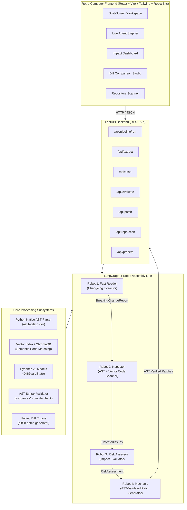

# DiffGuard AI — System Architecture

## 1. High-Level Architecture Overview

DiffGuard AI follows a modular, decoupled architecture consisting of a Python LangGraph-based core engine exposed via FastAPI, paired with a modern React + TypeScript + Tailwind CSS frontend featuring retro-computer aesthetics.



---

## 2. LangGraph StateGraph Schema (`DiffGuardState`)

The state flows sequentially through the 4-robot graph:

```python
class DiffGuardState(BaseModel):
    # Step 1: Input
    raw_changelog: str
    source_code: str
    file_path: Optional[str] = "main.py"
    
    # Step 2: Extractor Output
    library_name: Optional[str] = None
    version_from: Optional[str] = None
    version_to: Optional[str] = None
    breaking_changes: List[BreakingChangeItem] = Field(default_factory=list)
    extractor_logs: List[str] = Field(default_factory=list)
    
    # Step 3: Inspector Output
    ast_nodes_scanned: int = 0
    detected_issues: List[DetectedIssue] = Field(default_factory=list)
    inspector_logs: List[str] = Field(default_factory=list)
    
    # Step 4: Risk Assessor Output
    overall_risk_score: int = 0  # 0 to 100
    traffic_light: str = "GREEN"  # "RED" | "YELLOW" | "GREEN"
    risk_summary: str = ""
    issue_severities: Dict[str, str] = Field(default_factory=dict)
    assessor_logs: List[str] = Field(default_factory=list)
    
    # Step 5: Mechanic Output
    patched_code: Optional[str] = None
    unified_diff: Optional[str] = None
    is_ast_valid: bool = False
    ast_validation_error: Optional[str] = None
    mechanic_logs: List[str] = Field(default_factory=list)
    
    # Status & Telemetry
    current_step: str = "idle"
    completed_steps: List[str] = Field(default_factory=list)
    error: Optional[str] = None
    execution_time_ms: float = 0.0
```

---

## 3. The 4-Robot Assembly Line Nodes

### Node 1: `extract_changelog`
- Parses release notes using deterministic pattern matching, regex for signatures/deprecations, or structured LLM prompts.
- Extracts `BreakingChangeItem`: old signature, new signature, reason, parameter alterations, and replacement template.

### Node 2: `scan_code`
- Traverses code using Python's built-in `ast` module (`ast.parse` and custom `ast.NodeVisitor`).
- Tracks import aliases (`import stripe as st`, `from openai import ChatCompletion`).
- Identifies Call nodes, Attribute lookups, and keyword argument discrepancies.
- Computes semantic similarity between changelog symbols and code tokens using cosine similarity / vector indexing.

### Node 3: `evaluate_impact`
- Classifies each detected issue:
  - Critical `RED`: Runtime crash (`AttributeError`, `TypeError`, removed endpoints).
  - Warning `YELLOW`: Deprecated warning emitted or non-critical argument shift.
  - Informational `GREEN`: Cosmetic or safe optimization.
- Calculates composite risk score and generates plain-English impact narrative.

### Node 4: `generate_patch`
- Generates modernized code replacing obsolete API invocations.
- Applies AST syntax verification guardrail:
  ```python
  try:
      ast.parse(patched_code)
      is_valid = True
  except SyntaxError as e:
      is_valid = False
      error = str(e)
  ```
- If AST parsing succeeds, creates unified diff via `difflib.unified_diff`.

---

## 4. Multi-File & Repository Scanning Pipeline
- Traverses a local project directory.
- Filters Python source files (`*.py`), excluding virtual environments and cache directories.
- Batches files through Robot 2, 3, and 4.
- Generates a multi-file migration bundle and downloadable `.diff` patch file.

---

## 5. Directory Structure
```
diffguard-ai/
├── PRD.md
├── architecture.md
├── rules.md
├── phases.md
├── design.md
├── memory.md
├── APPLICATION_DOCUMENTATION.md
├── backend/
│   ├── app/
│   │   ├── __init__.py
│   │   ├── main.py
│   │   ├── config.py
│   │   ├── models/
│   │   │   ├── __init__.py
│   │   │   ├── schemas.py
│   │   │   └── state.py
│   │   ├── engine/
│   │   │   ├── __init__.py
│   │   │   ├── ast_parser.py
│   │   │   ├── vector_index.py
│   │   │   ├── patch_engine.py
│   │   │   └── langgraph_assembly.py
│   │   ├── api/
│   │   │   ├── __init__.py
│   │   │   ├── router.py
│   │   │   └── presets.py
│   ├── tests/
│   │   ├── __init__.py
│   │   ├── test_ast_parser.py
│   │   ├── test_langgraph_pipeline.py
│   │   ├── test_api_endpoints.py
│   │   └── test_patch_engine.py
│   └── requirements.txt
└── frontend/
    ├── package.json
    ├── vite.config.ts
    ├── tailwind.config.js
    ├── src/
    │   ├── main.tsx
    │   ├── App.tsx
    │   ├── components/
    │   │   ├── reactbits/
    │   │   │   ├── DecryptedText.tsx
    │   │   │   ├── SpotlightCard.tsx
    │   │   │   ├── ShinyText.tsx
    │   │   │   └── Squares.tsx
    │   │   ├── layout/
    │   │   │   ├── Header.tsx
    │   │   │   ├── CRTEffect.tsx
    │   │   │   └── Footer.tsx
    │   │   ├── workspace/
    │   │   │   ├── SplitWorkspace.tsx
    │   │   │   ├── ChangelogPanel.tsx
    │   │   │   └── CodeEditorPanel.tsx
    │   │   ├── pipeline/
    │   │   │   ├── AgentStepper.tsx
    │   │   │   └── RobotStatusPill.tsx
    │   │   ├── results/
    │   │   │   ├── ImpactDashboard.tsx
    │   │   │   ├── DiffViewer.tsx
    │   │   │   └── RepoScannerView.tsx
    │   └── services/
    │       └── api.ts
```
